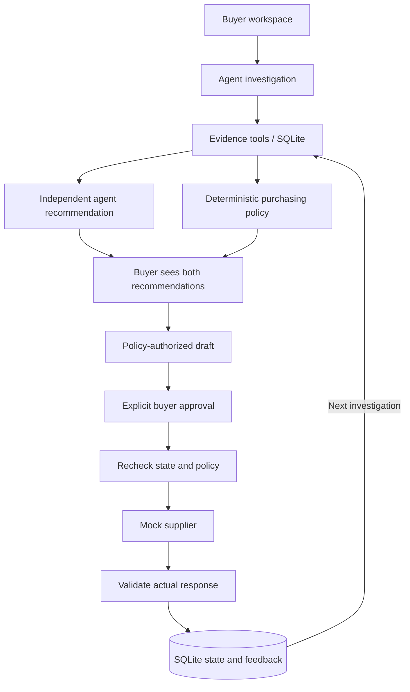

# Rappi AI Purchasing Agent

A full-stack demo that investigates purchasing situations, recommends an action, and executes a mock order after buyer approval. It validates the supplier's response and uses the outcome in the next investigation.

**Stack:** FastAPI · vanilla JavaScript · LangGraph / LangChain · Ollama · SQLite · DeepEval


## What is implemented?

| Assignment scenario | Demonstrated behavior |
|---|---|
| Review an 800-unit recommendation | Check existing supply and demand; revise the proposal to a feasible 150-unit order. |
| Supplier confirms only 250 of 500 units | Calculate the actual remaining need and prepare a supplemental order when necessary. |
| Sales increase while an order is open | Reassess coverage using recent sales and adjust the purchasing plan. |
| Purchasing constraints | Block infeasible orders based on budget, storage, supplier terms, or delivery timing. |

The first three scenarios support the full investigation → buyer approval → mock purchase → validation flow. Supplier rejection and partial confirmation also feed into the next investigation.

## Run the demo

Requires Docker with Docker Compose. From the repository root:

```bash
cp .env.example .env
docker compose up --build -d --wait
```

Open **<http://localhost:8000>**. API documentation is at <http://localhost:8000/docs>.

The default is **scripted mode**: a repeatable model double exercises the real workflow, tools, policy, database, and approval path without a model service. It does not demonstrate LLM reasoning. To run the real Ollama agent, follow [Live model setup](SETUP.md#run-the-real-agent-with-containerized-ollama). Native Python setup and all environment variables are also in [SETUP.md](SETUP.md).

Stop with `docker compose down`. Purchases persist in a Docker volume; `docker compose down -v` deletes this project's stored purchasing data and Ollama models/authentication. If port 8000 is occupied, change `PORT` in `.env`.

### Suggested evaluation journey

1. Choose **Review a recommendation to buy 800 units** and click **Review this situation**. Inspect the evidence, the policy's 150-unit proposal, and the independent agent recommendation.
2. Approve the order with the full-confirmation supplier response. Check the validation result, updated budget, and incoming stock.
3. Investigate again. The committed incoming order is counted, preventing another unnecessary purchase.
4. Start the **supplier shortfall** example over, investigate, and choose a partial or rejected supplier response before approval. Investigate again to see the saved feedback and remaining need.
5. Try the budget and storage examples. Neither produces an executable order.

Use **Start this example over** to restore a fixture. Reset advances its revision, so previously created drafts become stale.

## How the agent works

1. **Investigate:** the agent reads situation details, inventory/open orders, demand evidence, and supplier terms. It produces an independent recommendation.
2. **Apply policy:** deterministic code validates evidence and independently calculates permitted order terms. It checks coverage, supplier minimums/pack sizes, availability, capacity, cost, storage, and arrival timing.
3. **Present for review:** the buyer sees both recommendations and any disagreement. Only a policy-authorized purchase can become a draft.
4. **Approve and execute:** explicit buyer approval triggers a fresh policy/state check before calling the mock supplier. Repeated approval returns the existing result without spending again.
5. **Validate the outcome:** compare confirmed quantity, price, supplier, ETA, and cost with the approved terms. Persist the actual commitments and feedback for the next investigation.



The policy validates data shape, completeness, freshness, and purchasing constraints; it does not establish the real-world truth of a mock feed. The model cannot approve or place orders. A disagreement or unavailable final model answer is shown to the buyer and does not itself block a draft if the required evidence was collected and policy allows it.

### Feedback example

In the supplier-shortfall fixture, the gap is 110 units; supplier minimum and pack rules produce a 150-unit proposal. A rejection leaves the gap at 110. Confirmation of half the order commits 75 units, leaving a 35-unit gap.

The next investigation reads this feedback and updated incoming stock. The policy prevents retrying unchanged failed supplier terms. With no eligible alternative, it requests buyer review. Every new order requires fresh approval; recovery never places an automatic replacement order.

## Tests and evaluations

For the native development environment:

```bash
uv sync --locked
uv run pytest
uv run ruff check backend evaluations tests
```

DeepEval measures the **independent model answer**, rather than substituting the policy's answer:

| Metric | What it checks |
|---|---|
| Tool efficiency | Were the four required evidence tools called once with valid arguments? |
| Answer correctness | Do the decision, quantity, supplier, and cost match the versioned expected answer? |
| Groundedness | Does an LLM judge consider the recommendation and explanation supported by the tool evidence? |

There are eight starting evaluation situations and two recovery checks: ten answers in total. **Every DeepEval run requires a reachable Ollama judge, including runs with the scripted agent.** Configure the model using [SETUP.md](SETUP.md), then run:

```bash
# Repeatable agent; real groundedness judge
uv run python -m evaluations.run_eval --provider scripted --output .data/evals-scripted.json

# Real Ollama agent and judge
uv run python -m evaluations.run_eval --provider ollama --output .data/evals-live.json
```

The UI's **Run checks** button uses the scripted agent and the configured real judge. For container commands and exporting reports, see [SETUP.md](SETUP.md#save-evaluation-reports-from-docker).

**Recorded verification (2026-10-30):** 15 tests passed, and 12 Docker HTTP/persistence checks passed. All ten scripted answers passed tool efficiency and correctness with a fixed test judge; its groundedness scores verify wiring only. The live run matched **8/10 model answers**, passed tool efficiency on **9/10**, and passed all three metrics on **4/10**. Model errors and judge grading errors were both observed; the judge threshold is diagnostic and uncalibrated. See [the detailed assessment](ASSIGNMENT_ASSESSMENT.md) for failure analysis and verification scope.

## Code guide

| Location | Responsibility |
|---|---|
| `frontend/` | Buyer workspace, approval controls, evidence trace, and evaluation view. |
| `backend/server.py` | HTTP validation, API endpoints, and static UI serving. |
| `backend/agent/` | Investigation graph, evidence tools, model configuration, and independent-review comparison. |
| `backend/purchasing/` | Domain schemas, purchasing policies, supplier-response validation, and feedback rules. |
| `backend/mock/` | Demo situations, scripted model, and simulated supplier. |
| `backend/store.py` | SQLite state, drafts, atomic approvals, and audit history. |
| `evaluations/` and `tests/` | Versioned scenarios, evaluation metrics/runner, and unit/integration tests. |

## Scope and assumptions

This is an assignment prototype with mock operational data and suppliers. Each situation has its own budget and storage envelope. The fixtures use a 14-day planning horizon plus two safety days, count only confirmed incoming supply, and conservatively require all committed stock to fit storage. Missing or stale evidence blocks authorization.

Production authentication, live ERP/supplier integration, and shared multi-product/node allocation are outside the demo. The core assignment requirements are implemented, with the live-model and evaluation limitations disclosed above. Detailed setup is in [SETUP.md](SETUP.md); the requirement mapping is in [ASSIGNMENT_ASSESSMENT.md](ASSIGNMENT_ASSESSMENT.md).
