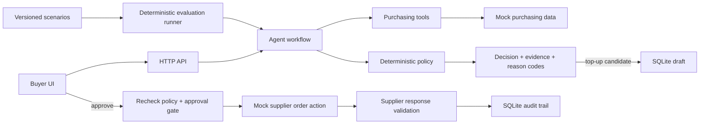

# Rappi AI Purchasing Agent

A runnable, full-stack buyer workflow demo for supplier shortfalls. It gathers purchasing evidence through tools, applies a deterministic policy, requests buyer approval before an order, and validates the supplier's response. All data and supplier responses are mocked; the application runs without an LLM key or third-party Python packages.

## Run locally

Requires Python 3.10 or newer.

```bash
python3 -m backend.server
```

Open <http://127.0.0.1:8000>. Select a situation and choose **Investigate situation**. For a recommended order, approve it to simulate supplier confirmation, or choose **Simulate supplier rejection** to see the failed-action feedback path. The app stores action and validation events in `.data/purchasing.sqlite3`.

Run the deterministic evaluation scenarios with:

```bash
python3 -m evaluations.run_eval
```

The app binds to localhost on port 8000. The `.env.example` is included as the extension point for optional external services; the demo has no required environment variables.

## Implemented scenario and mock data

The end-to-end scenario is a 500-unit open order whose supplier confirms only 250. The agent checks on-hand inventory, daily demand, supplier lead time, safety-stock coverage, open-order confirmation, alternate supplier availability and terms, remaining budget, and storage capacity. Four curated cases exercise a supplemental order, no action when available supply covers demand, budget escalation, and storage escalation.

The purchasing need is defined as demand over the incumbent supplier's lead time plus safety days. Available coverage is on-hand inventory plus supplier-confirmed incoming units. If there is a gap, the policy rounds the top-up to the alternate supplier's minimum and pack multiple, then checks capacity, budget, and storage. It does not silently shrink the order to fit a constraint; it escalates with reason codes.

## Architecture



### Responsibility boundaries

- `backend/agent/agent.py` orchestrates the investigation and returns the recommendation, trace, and any approval draft.
- `backend/agent/tools.py` exposes the data lookup, constraint lookup, draft, execution, and validation operations. Tool calls are captured for inspection.
- `backend/agent/policy.py` computes coverage and authorizes a suggested quantity. The order action is never authorized by model-generated prose.
- `backend/store.py` persists draft state and auditable events in SQLite. A draft can only be executed while awaiting approval; repeated execution is rejected.
- `backend/server.py` serves the UI and JSON endpoints. It reruns the policy before approval and blocks execution if the recommendation has changed.
- `frontend/` provides the buyer-facing scenario, evidence, activity trace, decision, approval, validation, and evaluation views.

The orchestration is intentionally deterministic and self-contained for a reproducible demo. This follows the useful `ref_agent` boundary: an agent coordinates tools and explains the result, while business rules control eligibility and side effects. Purchasing quantities, constraints, approval, and validation are hard-coded as auditable policy rather than delegated to an unconstrained LLM. A hosted LLM can later be added for free-form request interpretation or explanation without changing the policy authorization boundary.

## Decisions and actions

The policy returns one of:

- `supplemental_purchase`: a top-up fits supplier minimum/pack rules, budget, and storage. It creates a draft but does not place an order.
- `no_action`: current stock plus confirmed incoming supply covers the target window.
- `escalate`: supply is insufficient but an action is blocked, for example by budget or storage. No order is created.

The buyer must approve a draft. Before executing it, the API checks that the case still yields the same supplier, quantity, and actionable decision. The mock supplier then either confirms or rejects the order. Validation records the actual result; a rejection stays a failed outcome and gives the buyer a reassessment path.

## Evaluation approach

`evaluations/dataset.json` is versioned and lists expected decisions, required tool calls, purchasing constraints, and approval expectations. `evaluations/run_eval.py` evaluates each scenario with deterministic checks for decision correctness, information gathering, side-effect boundaries, approval, and constraints. It also runs one successful supplier-confirmation round trip and one rejected-order round trip to check the feedback loop.

The evaluation is intentionally not an LLM judge: these outcomes are exact business contracts. It reports per-case and per-check pass/fail, and exits nonzero if any criterion fails. The front end calls the same runner so the demo can show the evaluation results.

## API

- `GET /api/cases` — curated mock purchasing situations
- `POST /api/agent/run` with `{"case_id":"supplier-shortfall"}` — investigate and return decision, evidence, tool trace, and optional draft
- `POST /api/drafts/{draft_id}/approve` with `{}` — approve, execute, and validate a draft
- `POST /api/drafts/{draft_id}/approve` with `{"simulate_failure":true}` — exercise supplier rejection and validation
- `GET /api/events?case_id=supplier-shortfall` — recent persisted audit events
- `GET /api/evals` — run and return the deterministic evaluation report

## Current boundaries

This assignment demo focuses on supplier shortfall and purchasing constraints. Data is static mock data, supplier confirmation is simulated, and the policy uses a single coverage horizon. It does not connect to a live ERP, forecast service, or supplier system. The other assignment scenarios can be added as separate workflows sharing the same tool, policy, approval, audit, and evaluation boundaries.
