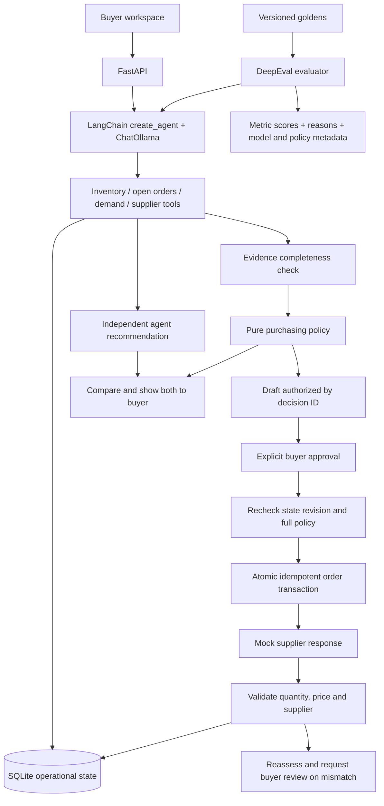

# Rappi AI Purchasing Agent


A full-stack purchasing application using **LangGraph**, **LangChain `create_agent`**, **ChatOllama**, deterministic policy checks, SQLite, FastAPI, and **DeepEval**. An agent reviews evidence independently; the application computes a policy decision and presents both to the buyer. The application prepares a policy-authorized draft, the buyer approves it, and the supplier's response is validated.

## Run with Docker Compose

Requires Docker Engine/Desktop with the Compose plugin. Run these commands from the repository root:

```bash
cp .env.example .env
docker compose up --build -d --wait
```

Open <http://localhost:8000> for the buyer workspace, <http://localhost:8000/docs> for the API schema, or <http://localhost:8000/health> for process health. If port 8000 is occupied, set `PORT=8020` in `.env` and use that port instead.

The default `AGENT_PROVIDER=scripted` runs a repeatable demo without Ollama, credentials, or model downloads. It executes the real LangChain/LangGraph workflow, tools, purchasing policy, SQLite transactions, approval, and supplier validation using a deterministic model double. The UI labels this mode; it does not demonstrate LLM reasoning. **Run DeepEval still needs a real judge**, even in scripted mode; configure Ollama before using that button.

```bash
docker compose logs -f app              # server/model errors
docker compose ps                      # app should become healthy
docker compose down                    # stop; keep purchasing data
```

The image serves both FastAPI and the static frontend; no Node build or external database is required. It installs runtime dependencies from `uv.lock` and runs as a non-root user. Compose stores SQLite and CLI evaluation reports in the `purchasing_data` volume at `/app/.data`. Rebuilding or restarting preserves purchases and budgets. Use the UI's reset control to restore one scenario. `docker compose down -v` deletes **all Compose purchasing data and Ollama models/authentication** for this project.

### Run the real agent with containerized Ollama

Start the optional model service and provision the model:

```bash
docker compose --profile ollama up -d ollama
docker compose exec ollama ollama signin
docker compose exec ollama ollama pull gpt-oss:20b-cloud
```

Complete the sign-in link printed by Ollama. The example model is cloud hosted: it requires an Ollama account and network access. Its authentication stays in the `ollama_data` volume, outside Git and the app image. For an entirely local model, pull a tool-capable model supported by your machine instead and use its exact name for both model variables below; cloud sign-in is then unnecessary.

Set these values in `.env`:

```dotenv
AGENT_PROVIDER=ollama
AGENT_MODEL=gpt-oss:20b-cloud
DEEPEVAL_JUDGE_MODEL=gpt-oss:20b-cloud
DOCKER_OLLAMA_BASE_URL=http://ollama:11434
```

Then recreate the application so it reads the changed environment:

```bash
docker compose --profile ollama up -d --wait
```

Wait for the pull to finish before investigating. `/health` reports the selected provider, but does **not** probe model availability or cloud authentication. Inspect `docker compose logs app` and `docker compose logs ollama` if a run returns an unavailable recommendation.

### Use an existing Ollama service

Leave the `ollama` profile off and set `DOCKER_OLLAMA_BASE_URL` to a URL reachable **from the app container**. For Ollama on the Docker host, use `http://host.docker.internal:11434`; the host service must listen on a container-reachable interface and the firewall must permit it. Docker maps `host.docker.internal` through `host-gateway`. A host Ollama listener bound only to `127.0.0.1` may need reconfiguration. Alternatively, use the containerized service above.

`127.0.0.1` inside the app container means the app container itself. Native Python uses `OLLAMA_BASE_URL`; Compose deliberately uses `DOCKER_OLLAMA_BASE_URL` to avoid mixing the two addresses. After any `.env` change, run `docker compose up -d` to recreate affected containers.

## Run directly with Python

Requires Python 3.12+ and [uv](https://docs.astral.sh/uv/). Dependencies are pinned in `uv.lock`.

```bash
cp .env.example .env
uv sync --locked
uv run python -m backend.server
```

Open <http://127.0.0.1:8000>. This uses the same scripted default. To run a live agent against a host Ollama installation:

```bash
ollama signin                          # required only for a cloud model
ollama pull gpt-oss:20b-cloud
AGENT_PROVIDER=ollama uv run python -m backend.server
```

Ollama must already be serving at `OLLAMA_BASE_URL` (default `http://127.0.0.1:11434`). Start its application/service or `ollama serve` if needed. Native state is `.data/purchasing-v2.sqlite3`, separate from the Docker volume.

### Configuration

Copy `.env.example` to `.env` and edit it. No application API key is required. Do not commit `.env` or model credentials.

| Variable | Purpose / example |
|---|---|
| `AGENT_PROVIDER` | `scripted` for the offline demo; `ollama` for real model reasoning. The example/Compose default is scripted; Python without an `.env` defaults to Ollama. |
| `AGENT_MODEL` | Ollama agent model; default `gpt-oss:20b-cloud`. Must support tool calls. |
| `OLLAMA_BASE_URL` | Native Python model/judge endpoint; default `http://127.0.0.1:11434`. |
| `DOCKER_OLLAMA_BASE_URL` | Compose model/judge endpoint; default `http://ollama:11434`. |
| `DEEPEVAL_JUDGE_MODEL` | Judge supporting structured output; defaults to `AGENT_MODEL` if unset. Used for every DeepEval run. |
| `HOST` | Native bind address, default `127.0.0.1`. Docker always uses `0.0.0.0` internally. |
| `PORT` | Native port or Compose host port, default `8000`; Docker's internal port is always `8000`. |
| `DEEPEVAL_TELEMETRY_OPT_OUT` | `YES` disables DeepEval telemetry. |

## Three assignment features

| Feature | Investigation and decision | End-to-end action |
|---|---|---|
| Purchase recommendation review | Recheck an 800-unit recommendation against inventory, confirmed incoming supply, forecast, supplier rules, budget, and storage. Accept, modify, reject, or investigate. | Prepare the corrected order, obtain buyer approval, place it with the mock supplier, and validate confirmation. |
| Supplier shortfall | Investigate an existing 500-unit order whose supplier confirms only 250. Determine whether alternate supply is actually needed. | Prepare a supplemental order or choose no action/escalation. Handle full confirmation, rejection, or partial fulfilment. |
| Demand / forecast change | Compare the old forecast with recent sales, checking freshness and at least three days of observations. Recalculate coverage with the existing order. | Adjust the purchasing plan through the same approval, execution, and validation flow. |

Purchasing constraints from the fourth assignment scenario apply across all three features. Two extra demo cases demonstrate budget and storage blocks.

### Demo journey

1. Select **Review a recommendation to buy 800 units** and investigate. The policy changes it to 150 units because confirmed inventory already covers part of the planning target.
2. Compare the policy recommendation and independent agent recommendation, then expand detailed reasoning and individual tool calls. A match compares the decision and, for a purchase, quantity, supplier and cost; it does not compare reasons.
3. Approve the draft with **Confirm full quantity**. The mock purchase is persisted, the budget is debited once, and confirmed incoming stock is updated.
4. Investigate again: the new incoming order is included, preventing duplicate buying.
5. Reset the demo situation and choose **Reject the order** or **Confirm half the quantity** before approval. The feedback loop records the actual response, recalculates the remaining gap, and creates a buyer-review event.
6. Try the budget and storage cases. Neither exposes an executable order.

Reset restores that fixture and advances its revision. Any previously issued draft becomes stale. The mock response dropdown simulates supplier behaviour; the buyer's approval and supplier acceptance are distinct events.

## Architecture



The model receives the evidence and rule descriptions, then recommends independently without receiving the policy result. Deterministic code computes the policy decision and draft terms. The buyer sees agreement, disagreement, or an unavailable review; buyer approval remains necessary for an order. The scripted reviewer is a reproducible test implementation, not evidence of independent model reasoning.

- `backend/agent/workflow.py`: outer LangGraph investigation nodes and routes, including the independent LangChain agent, comparison, draft preparation, and result.
- `backend/agent/agent.py`: API-facing adapter for the compiled investigation graph.
- `backend/agent/llm.py`: provider selection and live ChatOllama configuration.
- `backend/agent/scripted_model.py`: deterministic test double used for reproducible demos and checks.
- `backend/action_feedback.py`: structured supplier-outcome evidence and failed-term retry protection.
- `backend/agent/tools.py`: evidence lookups, policy evaluation, and draft preparation. Only the four evidence tools are exposed to the model; the application invokes policy evaluation and draft preparation after the model finishes.
- `backend/agent/review.py`: structured agent recommendation validation and comparison against the policy decision.
- `backend/agent/policy.py`: deterministic policy graph for base and scenario validation, coverage, supplier selection, and authorization comparison.
- `backend/store.py`: operational state, drafts, supplier outcomes, audit trail, and atomic approval transaction.
- `backend/supplier.py`: replaceable mock supplier API and independent response validation. Unexpected price, supplier or arrival terms are quarantined from local budget and stock commitments.
- `backend/server.py`: validated HTTP requests, UI, human approval/rejection, demo reset, and evaluation endpoint.
- `evaluations/`: versioned goldens, DeepEval metrics, the required groundedness judge, and one runner.

## Gated policy layers

1. **Evidence gate:** the model may read the four evidence tools; it cannot invoke the policy or draft tools. The application runs the policy after evidence collection. Missing, invalid, stale, or insufficient evidence causes investigation.
2. **Business policy gate:** calculate coverage, round to supplier minimum and pack size, then enforce availability, capacity, budget, storage, and arrival timing. Quantities and money are validated integers; currency calculations use cents.
3. **Draft gate:** the application prepares a draft using the policy-issued decision ID. The model cannot supply the authorized quantity, amount, or buyer approval. Drafts are deduplicated by case and revision.
4. **Buyer gate:** execution requires an explicit boolean approval in the API. The buyer can reject a draft without creating an order.
5. **Execution gate:** inside a SQLite write transaction, recompute policy and compare supplier, quantity, price, cost, ETA, revision, and policy version. Reject stale drafts. Repeated or concurrent approvals return the same order rather than spending twice.
6. **Feedback gate:** compare the supplier-confirmed quantity, price, and identity with the approved order. Rejections and partial confirmations remain unsuccessful validations. Persist their actual financial/stock effect and a reassessed gap requiring buyer review.

### Feedback in the next investigation

Every new supplier attempt records structured `action_feedback` in its situation:
requested, reported and committed quantities, expected/reported price and ETA,
failed validation checks, and the supplier's terms version. The next run receives
this evidence through `get_purchasing_situation`; the stock tool already includes
committed incoming units, so the agent must not add feedback quantities again.
Audit events remain separate from model context.

The shared policy blocks another order to a failed supplier using the same or
older `terms_version`. A feasible alternative can produce a new draft, which
requires fresh buyer approval. If no alternative passes all constraints, the
agent and policy request buyer review. Repeated investigations do not place
orders or clear a supplier failure.

An authoritative operational-data adapter can refresh supplier terms by updating
the situation through `Store.update_case` with a higher `terms_version` for that
supplier. Changing a case revision or budget alone does not unblock it. Existing
fixtures default to terms version 1. There is no live supplier-refresh integration
or buyer-facing refresh button; demo reset restores the fixture and clears its
feedback. Older persisted attempts are not backfilled from audit events.

For the shortfall fixture, rejection leaves a 110-unit gap and partial confirmation
of 75 units leaves a 35-unit gap. Both now escalate when the only supplier still
has failed terms. With an eligible alternate, recovery proposes 150 or 100 units
respectively, after supplier minimum/pack rules. Full confirmation produces no
additional purchase. This is evidence-informed replanning, not model training.

### Explicit domain assumptions

- Each demo situation is an isolated scenario with its own purchasing budget and storage envelope; cases can represent alternative versions of the same SKU. The budget is already net of existing order commitments. It is not a shared warehouse allocation optimizer.
- The planning target is effective daily demand × (14-day horizon + 2 safety days). Standard workflows use forecast demand; the demand-change workflow uses the higher of forecast and sufficiently evidenced recent sales.
- Demand freshness uses a supplied mock feed age; a live adapter would calculate it from timestamps. Only confirmed incoming units within the horizon count toward coverage. Daily projections catch stockouts that occur before deliveries, even if total units would eventually be enough.
- Supplier minimum and pack rules are purchase constraints. A partial supplier confirmation is an unexpected outcome to validate, rather than a new order that bypasses those rules.
- Storage is conservative: on-hand plus all committed incoming stock plus a proposed order must fit the configured capacity. No consumption-based storage optimization is assumed.
- No automatic retries place new orders after supplier rejection. The system reassesses the actual state and requires a new buyer decision.

## DeepEval flow

First configure a reachable Ollama service and judge, even for the scripted agent. To run in Docker (after the model setup above):

```bash
docker compose exec app python -m evaluations.run_eval --provider scripted --output .data/evals-scripted.json
docker compose exec app python -m evaluations.run_eval --provider ollama --output .data/evals-live.json
mkdir -p .data
docker compose cp app:/app/.data/evals-live.json .data/evals-live.json
```

Evaluations use temporary databases and do not spend the demo workspace's budget. A report includes each recommendation, expected terms, tool trace, judge reasons, model/provider, dataset/policy versions, and run timestamp. The CLI exits nonzero if any metric fails. Use `--cases review-modify supplier-rejection-feedback` to select dataset IDs (these differ from UI case IDs). The UI runs the full scripted suite synchronously and displays its response; use the CLI for a durable JSON file.

For native Python:

```bash
# Scripted agent with a real groundedness judge
uv run python -m evaluations.run_eval --provider scripted --output .data/evals-scripted.json

# Live Ollama agent with the same three metrics
uv run python -m evaluations.run_eval --provider ollama --output .data/evals-live.json
```

Every run evaluates the independent agent recommendation using three metrics:
`tool_efficiency` measures whether the four required evidence tools were called
once with valid arguments, `answer_correctness` compares the model's structured
answer with the versioned expected decision and order terms, and `groundedness`
uses a GEval judge to assess the recommendation and reason against actual tool
results. The grounding threshold is diagnostic until calibrated against reviewed
human labels. No policy decision is passed to the judge as evidence.

The dataset contains eight situations, including confirmed and rejected supplier
outcomes that trigger two additional recovery evaluations. The judge needs a
reachable Ollama service even when the agent provider is `scripted`. Configure
`OLLAMA_BASE_URL` and `DEEPEVAL_JUDGE_MODEL` for the judge. The UI's **Run DeepEval**
button uses the scripted agent and the configured judge.

## Tests

```bash
uv run pytest
uv run ruff check backend evaluations tests
```

The suite has 12 unit tests and 3 integration tests. The integration tests use
an isolated SQLite store and a fixed test judge; that judge checks the evaluator
wiring and does not establish the quality of real groundedness judgments. See the [unit tests](tests/test_unit.py), [integration tests](tests/test_integration.py), and [assignment assessment](ASSIGNMENT_ASSESSMENT.md) for the current checks and limits.

Generated run JSON under `evaluations/reports/` and `.data/` is ignored by Git; `evaluations/dataset.json` remains versioned. New reports go under `.data/`. Historical reports do not establish results for the current dataset and metrics.

## API and operational data

FastAPI's interactive schema is at <http://127.0.0.1:8000/docs>.

- `GET /health` — model provider and framework
- `GET /api/cases` — current persisted purchasing situations
- `POST /api/agent/run` with `{"case_id":"supplier-shortfall"}` — model investigation, canonical decision, trace, and optional draft
- `POST /api/drafts/{id}/approve` with `{"approved":true,"outcome":"confirmed"}` — buyer gate, transaction, and validation; mock outcomes also include `rejected` and `partial`
- `POST /api/drafts/{id}/reject` — buyer rejection without purchase
- `GET /api/events?case_id=supplier-shortfall` — persisted audit events
- `POST /api/cases/{id}/reset` — reset a demo fixture and invalidate older drafts
- `GET /api/evals` — run the scripted DeepEval suite

SQLite persists data in `.data/purchasing-v2.sqlite3`. The demo binds to localhost and uses a mock buyer identity. Production authentication, a live ERP/supplier adapter, a shared multi-product budget allocator, and transactional integration with external suppliers are outside this assignment scope. Cloud models require network availability. Missing evidence blocks authorization. If a model reads all evidence but its final recommendation fails, the deterministic policy may still prepare a draft; the buyer sees an unavailable review and must explicitly approve any execution.

## Framework references

[LangChain agent API](https://reference.langchain.com/python/langchain/agents/factory/create_agent), [DeepEval custom metrics](https://deepeval.com/docs/metrics-custom), and [DeepEval tool correctness](https://deepeval.com/docs/metrics-tool-correctness).

## Assignment assessment

The PDF asks for at least one end-to-end purchasing scenario, a feedback loop, evaluation, setup instructions, an architecture diagram, mock data/services, a working demo, and `.env.example`. The current code implements the core functional scope across three scenarios, with scenario 4's constraints shared across them. The current live sweep matched 8/10 independent model answers and passed all metrics on 4/10 answers; both model errors and judge grading errors were observed. Canonical policy terms matched all ten goldens. Public submission details remain unverified. Production integrations are not required by the PDF.

See [the requirement-by-requirement assessment](ASSIGNMENT_ASSESSMENT.md) for verified behavior, gaps, and current checks. This is an assisted purchasing system: model advice is independent, policy controls draft terms, and the buyer authorizes execution. Multi-node allocation and production authentication are outside the implemented demo.
