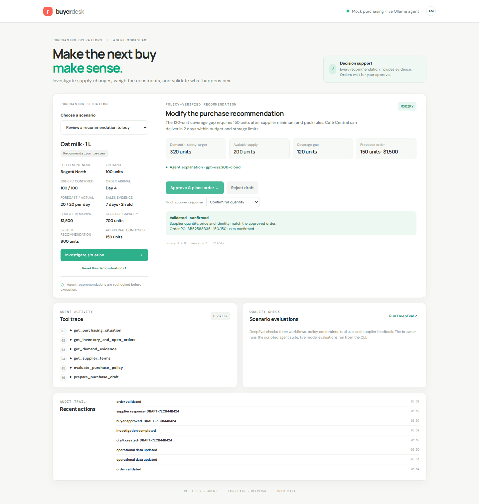
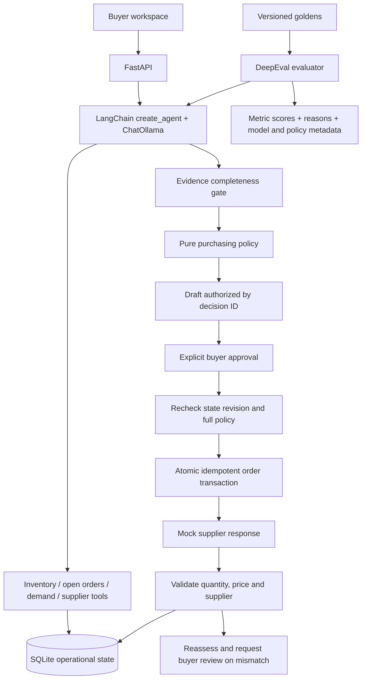

# Rappi AI Purchasing Agent



A full-stack purchasing application using **LangChain `create_agent`**, **ChatOllama**, deterministic policy gates, SQLite, FastAPI, and **DeepEval**. The agent selects evidence tools and prepares a policy-authorized draft. A buyer approves the purchase; the application checks the supplier's actual response and persists any required follow-up.

## Setup

Requires Python 3.12+ and [uv](https://docs.astral.sh/uv/). Dependencies are pinned in `uv.lock`.

```bash
uv sync
cp .env.example .env
uv run python -m backend.server
```

Open <http://127.0.0.1:8000>. The default agent uses Ollama at `http://127.0.0.1:11434` with the tool-capable `gpt-oss:20b-cloud` model. Install [Ollama](https://ollama.com/), start its service, and authenticate if your selected model uses Ollama cloud. You can change `AGENT_MODEL` and `OLLAMA_BASE_URL` in `.env`. A local model must support tool calling.

For a reproducible development demo without any model service:

```bash
AGENT_PROVIDER=scripted uv run python -m backend.server
```

This **scripted test mode** executes the same LangChain graph, real tool implementations, policy, database, and approval path. It is explicitly labelled in the UI and reports. It does not demonstrate model reasoning. Live Ollama runs are reported separately.

## Three assignment features

| Feature | Investigation and decision | End-to-end action |
|---|---|---|
| Purchase recommendation review | Recheck an 800-unit recommendation against inventory, confirmed incoming supply, forecast, supplier rules, budget, and storage. Accept, modify, reject, or investigate. | Prepare the corrected order, obtain buyer approval, place it with the mock supplier, and validate confirmation. |
| Supplier shortfall | Investigate an existing 500-unit order whose supplier confirms only 250. Determine whether alternate supply is actually needed. | Prepare a supplemental order or choose no action/escalation. Handle full confirmation, rejection, or partial fulfilment. |
| Demand / forecast change | Compare the old forecast with recent sales, checking freshness and at least three days of observations. Recalculate coverage with the existing order. | Adjust the purchasing plan through the same approval, execution, and validation flow. |

Purchasing constraints from the fourth assignment scenario apply across all three features. Two extra demo cases demonstrate budget and storage blocks.

### Demo journey

1. Select **Review a recommendation to buy 800 units** and investigate. The policy changes it to 150 units because confirmed inventory already covers part of the planning target.
2. Inspect the policy evidence and expand individual tool calls. The agent explanation is shown separately from the canonical policy result.
3. Approve the draft with **Confirm full quantity**. The mock purchase is persisted, the budget is debited once, and confirmed incoming stock is updated.
4. Investigate again: the new incoming order is included, preventing duplicate buying.
5. Reset the demo situation and choose **Reject the order** or **Confirm half the quantity** before approval. The feedback loop records the actual response, recalculates the remaining gap, and creates a buyer-review event.
6. Try the budget and storage cases. Neither exposes an executable order.

Reset restores that fixture and advances its revision. Any previously issued draft becomes stale. The mock response dropdown simulates supplier behaviour; the buyer's approval and supplier acceptance are distinct events.

## Architecture



The architecture carries forward `ref_agent`'s agent, tools, policy, and evaluation boundaries. Here, the model uses tools to investigate and explain; deterministic code computes the purchase quantity and authorizes side effects.

- `backend/agent/agent.py`: LangChain runtime, per-run tool state, model/tool call limits, bounded recovery for premature model completion, canonical result, trace, and run metadata.
- `backend/agent/llm.py`: real ChatOllama integration and a separately labelled scripted test model.
- `backend/agent/tools.py`: evidence lookups, policy evaluation, and draft preparation. The LLM has **no purchase execution tool**.
- `backend/agent/policy.py`: coverage, supplier selection, arrival timing, constraint enforcement, and authorization comparison.
- `backend/store.py`: operational state, drafts, supplier outcomes, audit trail, and atomic approval transaction.
- `backend/supplier.py`: replaceable mock supplier API and independent response validation. Unexpected price, supplier or arrival terms are quarantined from local budget and stock commitments.
- `backend/server.py`: validated HTTP requests, UI, human approval/rejection, demo reset, and evaluation endpoint.
- `evaluations/`: versioned goldens, DeepEval metrics, optional LLM judge, and one runner.

## Gated policy layers

1. **Evidence gate:** stage middleware exposes only the tools allowed at the current stage and supplies a matching system instruction. All four evidence tools must be read before the policy tool returns a decision ID. Missing, invalid, stale, or insufficient evidence causes investigation.
2. **Business policy gate:** calculate coverage, round to supplier minimum and pack size, then enforce availability, capacity, budget, storage, and arrival timing. Quantities and money are validated integers; currency calculations use cents.
3. **Draft gate:** the model can pass only a policy-issued decision ID. It cannot supply a purchase quantity, arbitrary amount, or buyer approval. Drafts are deduplicated by case and revision.
4. **Buyer gate:** execution requires an explicit boolean approval in the API. The buyer can reject a draft without creating an order.
5. **Execution gate:** inside a SQLite write transaction, recompute policy and compare supplier, quantity, price, cost, ETA, revision, and policy version. Reject stale drafts. Repeated or concurrent approvals return the same order rather than spending twice.
6. **Feedback gate:** compare the supplier-confirmed quantity, price, and identity with the approved order. Rejections and partial confirmations remain unsuccessful validations. Persist their actual financial/stock effect and a reassessed gap requiring buyer review.

### Explicit domain assumptions

- Each demo situation is an isolated scenario with its own purchasing budget and storage envelope; cases can represent alternative versions of the same SKU. The budget is already net of existing order commitments. It is not a shared warehouse allocation optimizer.
- The planning target is effective daily demand × (14-day horizon + 2 safety days). Standard workflows use forecast demand; the demand-change workflow uses the higher of forecast and sufficiently evidenced recent sales.
- Demand freshness uses a supplied mock feed age; a live adapter would calculate it from timestamps. Only confirmed incoming units within the horizon count toward coverage. Daily projections catch stockouts that occur before deliveries, even if total units would eventually be enough.
- Supplier minimum and pack rules are purchase constraints. A partial supplier confirmation is an unexpected outcome to validate, rather than a new order that bypasses those rules.
- Storage is conservative: on-hand plus all committed incoming stock plus a proposed order must fit the configured capacity. No consumption-based storage optimization is assumed.
- No automatic retries place new orders after supplier rejection. The system reassesses the actual state and requires a new buyer decision.

## DeepEval flow

```bash
# Repeatable LangChain graph + policy + feedback checks, with no network model calls
uv run python -m evaluations.run_eval --output .data/evals-scripted.json

# Real ChatOllama tool use on all 14 versioned scenarios
uv run python -m evaluations.run_eval --provider ollama --output .data/evals-live.json

# Add a real LLM judge for the explanations of the three core features
uv run python -m evaluations.run_eval --provider ollama --judge \
  --cases review-modify supplier-shortfall demand-spike \
  --output .data/evals-live-judge.json
```

The runner calls DeepEval `evaluate()` over actual agent outputs. Four custom `BaseMetric` implementations check decision correctness against independently specified expected outcomes, evidence-before-policy ordering, purchasing and approval invariants, and actual supplier feedback. DeepEval's built-in `ToolCorrectnessMetric` checks required tool selection. Domain checks additionally reject duplicate or unauthorized calls and require evidence before policy evaluation; the four independent evidence reads may occur in any order. Those five metrics are release contracts and do not invoke a judge model.

`--judge` adds `GEval` for buyer explanation quality using `DEEPEVAL_JUDGE_MODEL`. The judge receives operational evidence, the actual draft, and the authorized decision, so supported order details are not misclassified as hallucinations. Judge scores are diagnostic; their threshold is not a calibrated production release gate. Deterministic safety checks remain mandatory.

The dataset covers accept/modify/reject, all three features, no-op buying, budget/storage blocks, stale demand, insufficient sales history, supplier rejection and partial fulfilment, arrival timing, and injected instructions in operational text. Each case runs against isolated SQLite state. Reports include per-metric scores, thresholds, reasons, actual tool traces, provider/model, prompt hash, policy/dataset versions, and execution time. The runner exits nonzero when a measured criterion fails. The UI's **Run DeepEval** button runs the same scripted suite.

## Tests

```bash
uv run playwright install chromium
uv run pytest
uv run ruff check backend evaluations tests
node --check frontend/app.js
```

Tests exercise the three actual LangChain workflows; policy boundaries; forged authorization; missing buyer approval; stale price, budget, demand and ETA; concurrent approvals across database connections; restart persistence; supplier rejection and partial confirmation; malformed HTTP requests; intentionally broken outputs against the evaluator; and real Chromium buyer journeys on desktop and mobile. The automated browser suite uses the scripted model. Live model evidence is produced by the separate DeepEval commands above.

Checked-in verification results are in `evaluations/reports/` and `docs/VERIFICATION.md`. Full reports are generated under ignored `.data/`.

## API and operational data

FastAPI's interactive schema is at <http://127.0.0.1:8000/docs>.

- `GET /health` — model provider and framework
- `GET /api/cases` — current persisted purchasing situations
- `POST /api/agent/run` with `{"case_id":"supplier-shortfall"}` — model investigation, canonical decision, trace, and optional draft
- `POST /api/drafts/{id}/approve` with `{"approved":true,"outcome":"confirmed"}` — buyer gate, transaction, and validation; mock outcomes also include `rejected` and `partial`
- `POST /api/drafts/{id}/reject` — buyer rejection without purchase
- `GET /api/events?case_id=supplier-shortfall` — persisted audit events
- `POST /api/cases/{id}/reset` — reset a demo fixture and invalidate older drafts
- `GET /api/evals` — run the scripted DeepEval suite

SQLite persists data in `.data/purchasing-v2.sqlite3`. The demo binds to localhost and uses a mock buyer identity. Production authentication, a live ERP/supplier adapter, a shared multi-product budget allocator, and transactional integration with external suppliers are outside this assignment scope. Cloud models require network availability; unavailable models fail closed with investigation guidance.

## Framework references

[LangChain agent API](https://reference.langchain.com/python/langchain/agents/factory/create_agent), [DeepEval custom metrics](https://deepeval.com/docs/metrics-custom), and [DeepEval tool correctness](https://deepeval.com/docs/metrics-tool-correctness).
